# 04. Галерея: настоящая 1С и наше превью

Пары «скриншот 1С — наше превью» для реальных обычных форм. Слева — окно в запущенной 1С (в окне 1С лишние 8 px по ширине и 26 px по высоте — системная рамка и заголовок), справа — наше превью (только содержимое формы). Файлы лежат в `gallery/`. Это **эталон «как должно быть»**; цвета, измеренные на снимках, собраны в `01-how-1c-looks.md`.

> **Важно.** Текстовые описания различий ниже написаны человеком «на глаз». Там, где они расходятся с измеренными цветами (`01-how-1c-looks.md`: рамки, фон и шапки в 1С имеют ту же палитру `#FCFAEB / #B3AC86 / #F5F2DD`, что и превью), доверяйте измерениям и самим снимкам.

## Указатель

| № | Форма | Размеры (1С / превью) | Описание |
|---|---|---|---|
| 01 | Catalogs / Контрагенты / ФормаСписка | 694×326 / 686×300 | [01-kontr-list.md](gallery/01-kontr-list.md) |
| 02 | Catalogs / Организации / ФормаЭлемента | 548×460 / 540×434 | [02-org-item.md](gallery/02-org-item.md) |
| 04 | Catalogs / ВариантыРасчетаНалогов / ФормаЭлемента | 464×200 / 456×174 | [04-nalogi-radio.md](gallery/04-nalogi-radio.md) |
| 05 | Catalogs / ОформленияСтрокПисем / ФормаЭлемента | 408×235 / 400×209 | [05-ofor-font.md](gallery/05-ofor-font.md) |
| 06 | Documents / ПутевойЛист / ФормаДокумента | 858×590 / 850×564 | [06-putlist.md](gallery/06-putlist.md) |
| 09 | Reports / ОтчетПоПроводкам / ФормаОтчета | 828×584 / 820×558 | [09-rep-provodki.md](gallery/09-rep-provodki.md) |
| 15 | DataProcessors / ОбменДаннымиXML / Форма | 634×606 / 626×580 | [15-dp-xml.md](gallery/15-dp-xml.md) |
| 16 | DataProcessors / СтартовыйПомощник / Форма | 929×537 / 921×511 | [16-dp-start.md](gallery/16-dp-start.md) |

## Общие различия (по описанию галереи)

1. **Окно целиком.** В 1С у формы системная рамка, заголовок («Объект: Создание *», иконка, свернуть/закрыть) и нижняя полоса кнопок; в превью (`chrome=0`) заголовка и рамки нет, форма — просто бежевый холст.
2. **Содержимое полей.** 1С показывает реальные значения (даты, «0,00», выбранные элементы, «<Заполнение на основании не предусмотрено>»), числа выровнены вправо. Превью в полях без данных пишет серым курсивом путь привязки («СправочникОбъект.Наименование») — в 1С такого текста нет; поля с пустым значением в 1С просто белые.
3. **Рамка и цвет полей ввода.** В 1С поле — белое, тонкая серая рамка со слегка скруглёнными углами, внутри светлая внутренняя тень; кнопки «…», «лупа», календарь, «T», «×» слиты с полем в единый блок. В превью рамка коричнево-бежевая, прямоугольная, кнопки отдельные, «×» оранжевый.
4. **Закладки (Panel/Page).** В 1С: активная закладка белая и приподнята, остальные светло-серые, углы скруглены, все подписи полные, при нехватке места справа появляются стрелки прокрутки ◀▶. В превью: все закладки одной ширины, подписи обрезаются («Осно…», «Подч…»), тёплая бежево-оранжевая заливка, прямые углы.
5. **Шапка и тело таблицы.** В 1С шапка плоская светло-серая, разделители тонкие, у отсортированной колонки стрелка, в строках иконки, подсветка текущей строки тёмно-синяя, линии сетки светлые; в таблице реальные данные. В превью шапка бежевая с градиентом, подписи колонок обрезаются, строк нет (пустое белое поле с полосами прокрутки), колонка «Картинка» — без значков.
6. **Командная панель.** В 1С панели с `AutoFill=true` достраиваются стандартными кнопками (Действия ▾, Добавить, Копировать, Изменить, Удалить, фильтры, Перейти ▾, справка) и с цветными значками, кнопки без текста — плоские, неактивные серые; жирная кнопка («Сформировать отчёт», «Выгрузить данные») имеет стрелку. В превью — только «?», а явные кнопки идут с одной серо-синей иконкой-заглушкой, без отличий активных/неактивных.
7. **Группы с заголовком (UsualGroup SingleLine / Frame).** В 1С SingleLine — коричневато-оранжевый жирный заголовок с тонкой линией под ним (не рамка); Frame — тонкая серая рамка с подписью. В превью заголовок и линия похожи, но линия темнее и толще, Frame — прямоугольная коричневая.
8. **Шрифты.** 1С — системный шрифт (Tahoma 8 / Verdana там, где задан `Font face`), ClearType, жирный и цветной текст как в `Form.xml`. Превью — тот же Tahoma/Arial, но при другом рендеринге; `bold` есть, а `italic`, `underline`, `strikeout` у флажков, `face=Verdana` и переносы длинных подписей по словам (в 1С — несколько строк, в превью — одна строка с «…») не отображаются.
9. **Переключатели и флажки.** В 1С состояние берётся из данных (первый переключатель отмечен, флажки отмечены), элемент объёмный: белый квадрат с тенью. В превью всё не отмечено, элементы меньше, с тёмной плоской рамкой.
10. **Что делает код формы.** 1С скрывает и отключает элементы, меняет подписи, заполняет значения и закладки; превью исполняет только `Form.xml`: скрытые кодом поля («Подразделение», «Код НДС») показаны, недоступные («Настройка отладки выгрузки…») выглядят активными, текст-заготовки подписей («Всего: 500 EURO», автор «Шевчик Александр») остаются; картинки показываются стандартной заглушкой «небо/трава», в 1С — реальные или пустые рамки.

> Общая палитра: превью использует тёплую «палитру Конфигуратора 1С 8.2» (фон `#FCFAEB`, рамки `#B3AC86`, шапки `#FAF9EE→#F2EBCC`), а 1С в режиме «Предприятие» рисует форму в системных цветах Windows (светло-серый/кремовый фон, серые рамки, синее выделение).

## Пары

### 01. Catalogs / Контрагенты / ФормаСписка

| Настоящая 1С | Наше превью |
|---|---|
| 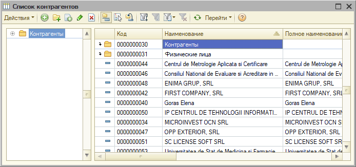 | 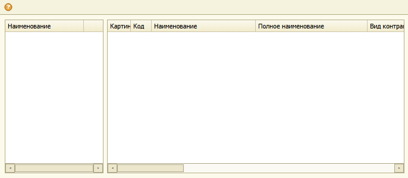 |

* Объект/форма: Catalogs/Контрагенты, `ФормаСписка`; размер формы 686×300 (в 1С окно 694×326 вместе с рамкой и заголовком).
* Открыта командой: `live.py Справочники.Контрагенты ФормаСписка list` (режим `list` — форма менеджера).
* Классы элементов: 2×Table, 1×CommandBar (AutoFill=true), 1×Splitter.
* Картинки: `01-kontr-list-1c.png` (1С), `01-kontr-list-preview.png` (превью). Дамп свойств из 1С — `01-kontr-list.txt`.

### Заметные свойства
* `СправочникДерево` (Table, 8,33 166×259): `ReadOnly=true`, одна колонка «Наименование» — дерево групп.
* `СправочникСписок` (Table, 180,33 500×259): 1-я колонка `Картинка` (Width 39, ReadOnly, без заголовка), далее Код (35), Наименование (175), Полное наименование (188), Вид контрагента …; `ChoiceMode=true`.
* `Разделитель` (Splitter, 174,33 6×259): `Orientation=Vertical`.
* `ОсновныеДействияФормы` (CommandBar, 0,0 686×25): `AutoFill=true` — кнопки в XML не заданы, платформа сама строит «Действия», «Добавить», «Копировать», «Изменить», «Удалить», отборы, «Перейти», справку.
* Привязки (`Anchors`): таблицы растянуты вправо/вниз с отступом 6–8.

### Отличия «1С — превью»
1. **Командная панель.** В 1С — плоская панель: меню «Действия ▾», цветные значки (зелёный плюс, копия, карандаш, красный крест), отборы, «Перейти ▾», справка. В превью — только значок «?» (AutoFill не разворачивается в стандартные кнопки).
2. **Заголовок окна.** В 1С у формы есть системная рамка и заголовок («Список контрагентов» с иконкой, кнопки развернуть/закрыть). В превью (`chrome=0`) заголовка нет, фон — тёплый бежевый.
3. **Данные.** В 1С таблицы заполнены строками (иконки групп/элементов, синяя подсветка текущей строки, лёгкие линии сетки). В превью таблицы пустые, видны только шапка и полосы прокрутки.
4. **Шапка таблицы.** В 1С — светло-серая плоская с тонкими вертикальными разделителями и значком сортировки «▲» у «Наименование». В превью — бежевый градиент, рамка толще, подписи колонок обрезаются («Картин», «Вид контра»).
5. **Дерево групп.** В 1С слева дерево без шапки с узлом «+» и иконкой папки; в превью то же поле показано как обычная таблица с шапкой «Наименование».
6. **Колонка-картинка.** В 1С в ней значки; в превью колонка с подписью «Картин…» без значков.

### 02. Catalogs / Организации / ФормаЭлемента

| Настоящая 1С | Наше превью |
|---|---|
| 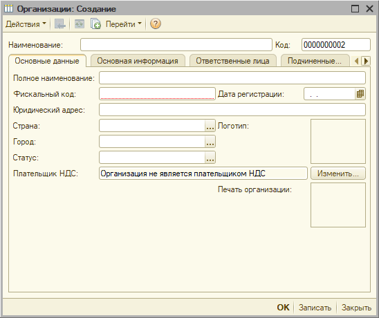 | 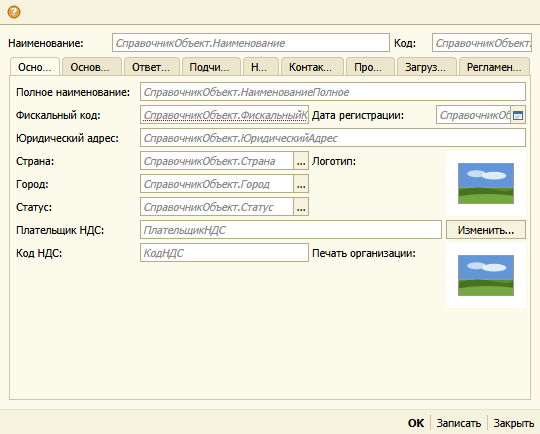 |

* Объект/форма: Catalogs/Организации, `ФормаЭлемента`; размер формы 540×434 (окно в 1С 548×460).
* Открыта: `live.py Справочники.Организации ФормаЭлемента new` (новый элемент, заголовок «Организации: Создание»).
* Классы: 40×LabelDecoration, 37×InputField, 10×Table, 2×Panel (15 Page), 5×UsualGroup, 3×PictureDecoration, 11×Button, CommandBar.
* Картинки: `02-org-item-1c.png`, `02-org-item-preview.png`.

### Заметные свойства
* `Панель` (Panel, 8,56 524×345): `ShowTabs` code=7 (закладки сверху, не умещаются — 9 страниц: «Основные данные», «Основная информация», «Ответственные лица», «Подчиненные объекты», …). Вложенная `ПанельПодчиненныеОбъекты`: code=5.
* Поля с кнопкой выбора «…»: `Страна`, `Город`, `Статус`, `ДатаРегистрации` (кнопка-календарь), ширины 169/90 при полях-строках 386 (`ЮридическийАдрес`, `ПолноеНаименование`).
* `ПлательщикНДС`, `КодНДС`: `ReadOnly=true` (в 1С — серая подпись «Организация не является плательщиком НДС», поле `КодНДС` скрыто при открытии).
* `ОсновноеИзображение`, `ПечатьОрганизации` (PictureDecoration 80×65): `PictureSize=Proportionally`.
* `РамкаКоды` и другие `UsualGroup`: `Font bold=true`, `BorderStyle=SingleLine` — заголовок-линия на других страницах.
* `НадписьИстория` (LabelDecoration): `Hyperlink=true`, цвет стиля — ссылка.
* Нижняя `ОсновныеДействияФормы`: `HorizontalAlign=Right`, кнопки «OK», «Записать», «Закрыть».

### Отличия «1С — превью»
1. **Закладки.** В 1С — широкие закладки с полными подписями, справа стрелки прокрутки ◀▶, активная — белая, остальные серые со скруглённым верхом. В превью все 9 закладок сжаты в равные узкие кнопки с обрезанными подписями («Осно…», «Подч…») и оранжево-бежевой заливкой.
2. **Поля без данных.** В 1С поля пустые (код «0000000002», дата « . . », «Организация не является…»). В превью в полях серым курсивом написан путь привязки («СправочникОбъект.Наименование») — это пояснение, в 1С такого нет.
3. **Обязательное поле.** В 1С у «Фискальный код» красное пунктирное подчёркивание (проверка заполнения). В превью его нет.
4. **Картинки.** В 1С пустые рамки 80×65 (картинок нет). В превью — заглушка «небо/трава».
5. **Командная панель и заголовок.** В 1С вверху системный заголовок «Организации: Создание» и панель «Действия ▾ … Перейти ▾ ?». В превью — только значок «?». Нижняя панель в 1С — на светло-серой полосе, кнопки «OK» жирным; в превью то же, но светлее и без рамки окна.
6. **Скрытое поле.** «Код НДС» в превью показано, в 1С при открытии скрыто (видимость выставляет модуль формы) — превью не выполняет код формы.

### 04. Catalogs / ВариантыРасчетаНалогов / ФормаЭлемента

| Настоящая 1С | Наше превью |
|---|---|
| 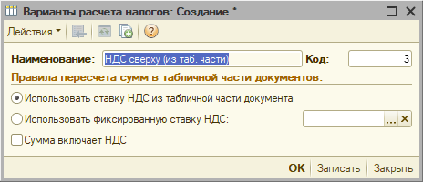 | 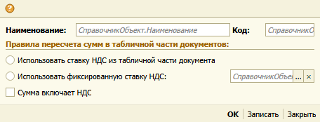 |

* Объект/форма: Catalogs/ВариантыРасчетаНалогов, `ФормаЭлемента`; размер 456×174 (окно в 1С 464×200). Открыта `… new`.
* Классы: 2×LabelDecoration, 3×InputField, 1×CheckBox, 2×RadioButton, 1×UsualGroup, CommandBar (2), 5 Button.
* Картинки: `04-nalogi-radio-1c.png`, `04-nalogi-radio-preview.png`.

### Заметные свойства
* `НадписьНаименование`, `НадписьКод` (LabelDecoration): `Font bold=true` (жирные подписи полей).
* `Рамка` (UsualGroup, 8,56 440×16, подпись «Правила пересчета сумм…»): `Font bold=true`, `BorderStyle=SingleLine` (в 1С — заголовок-разделитель: жирный коричнево-оранжевый текст + тонкая линия под ним, не рамка).
* `СтавкаНДС` (InputField 328,99 120×19): `ChoiceButton=true`, `ClearButton=true` → «…» и «×».
* `Наименование` (InputField 108,33 220×19): `ReadOnly=true`.
* Два `RadioButton` (переключатель) и `CheckBox` «Сумма включает НДС».
* `ОсновныеДействияФормы` (CommandBar 0,149): `HorizontalAlign=Right`, «OK / Записать / Закрыть».

### Отличия «1С — превью»
1. **Радиокнопки.** В 1С первая кнопка отмечена (заполненная точка), значение берётся из данных; в превью обе пустые.
2. **Поля.** В 1С в полях значения («НДС сверху (из таб. части)», «3» выровнено вправо, поле «Наименование» выделено синим как выбранный текст); в превью — серые курсивные пути привязки («СправочникОбъект.Наименование»).
3. **Кнопки поля.** В 1С «…» и «×» — единый блок, «×» с серым крестом, высота как у поля; в превью кнопки короче, «×» оранжевый, есть зазор между полем и кнопками.
4. **Заголовок окна.** В 1С «Варианты расчета налогов: Создание *» (звёздочка — изменено) с иконкой формы и кнопками окна; в превью заголовка нет, вместо панели «Действия ▾ …» одна иконка «?».
5. **Фон и рамка.** В 1С форма на светло-кремовом фоне с двойной бледной рамкой окна и узкой нижней полосой кнопок; в превью фон жёлтее, рамки окна нет.
6. **Подчёркивание группы.** В 1С линия под заголовком группы тонкая светло-оранжевая во всю ширину; в превью — такая же, но подпись и линия на пару пикселей выше.

### 05. Catalogs / ОформленияСтрокПисем / ФормаЭлемента

| Настоящая 1С | Наше превью |
|---|---|
| 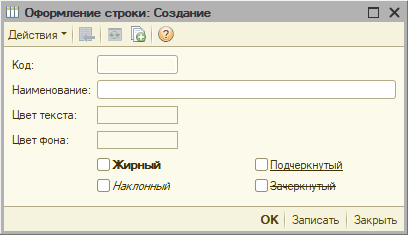 | 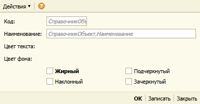 |

* Объект/форма: Catalogs/ОформленияСтрокПисем, `ФормаЭлемента`; размер 400×209 (окно в 1С 408×235). Открыта `… new`.
* Классы: 4×LabelDecoration, 2×InputField, 4×CheckBox, 2×PictureDecoration, CommandBar (2), 7 Button.
* Картинки: `05-ofor-font-1c.png`, `05-ofor-font-preview.png`.

### Заметные свойства (шрифты флажков)
* `Жирный` (CheckBox 93,135 142×15): `Font bold=true`.
* `Наклонный` (93,156): `Font italic=true`. `Подчеркнутый` (251,135): `Font underline=true`. `Зачеркнутый` (251,156): `Font strikeout=true`.
* `Код` (InputField 93,33 81×19): `ReadOnly=true`; `Наименование` — поле на всю ширину.
* `ЦветТекста`/`ЦветФона` — две пустые `PictureDecoration`-подобные рамки справа от подписей (в 1С это поля-образцы цвета с рамкой).
* `ОсновныеДействияФормы` (CommandBar 0,184): `HorizontalAlign=Right`.

### Отличия «1С — превью»
1. **Шрифт флажков.** В 1С «Наклонный» набран курсивом, «Подчеркнутый» подчёркнут, «Зачеркнутый» зачёркнут, «Жирный» жирный. В превью выделен только «Жирный»; курсив, подчёркивание и зачёркивание не отрисованы.
2. **Образцы цвета.** В 1С «Цвет текста» и «Цвет фона» — пустые прямоугольники с тонкой серой рамкой, закруглённые углы у «Код». В превью на их месте ничего нет (подписи есть, поля нет).
3. **Поле «Код».** В 1С — закруглённое белое поле с рамкой, пустое; в превью — серый курсивный путь «СправочникОбъ…» в прямоугольной рамке.
4. **Рамки полей.** В 1С рамка полей тонкая тёмно-серая со скруглением 2–3 px; в превью — коричнево-бежевая прямоугольная.
5. **Флажки.** В 1С квадрат белый с серой рамкой и объёмной тенью, галки нет; в превью меньше, рамка тёмная плоская.
6. **Заголовок и панель.** В 1С заголовок «Оформление строки: Создание» и панель «Действия ▾» с неактивными значками; в превью только «Действия ▾» и «?», без заголовка окна.

### 06. Documents / ПутевойЛист / ФормаДокумента

| Настоящая 1С | Наше превью |
|---|---|
| 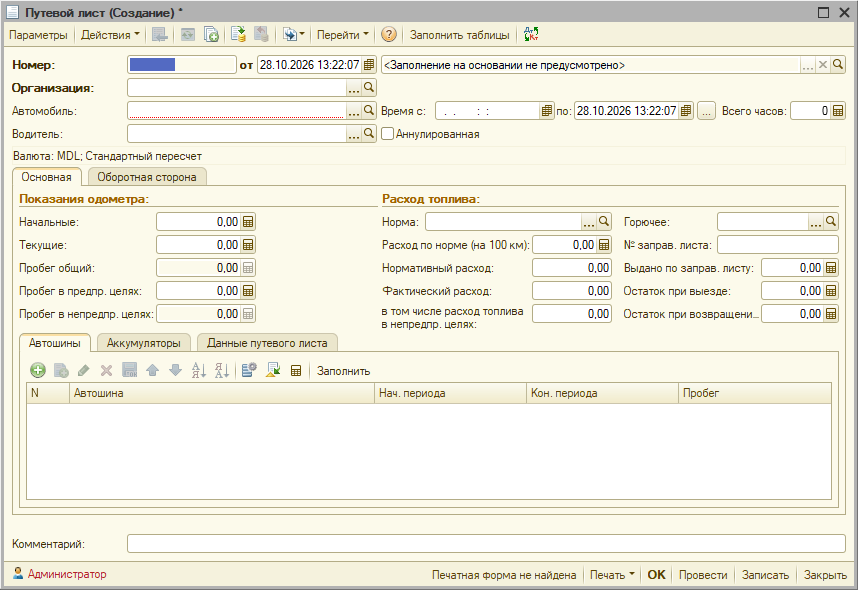 | 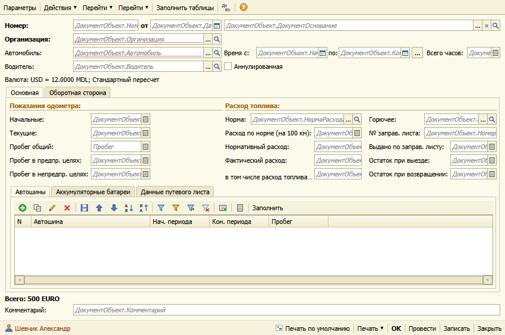 |

* Объект/форма: Documents/ПутевойЛист, `ФормаДокумента`; размер 850×564 (окно в 1С 858×590). Открыта `Документы.ПутевойЛист ФормаДокумента new`.
* Классы: 33×LabelDecoration, 30×InputField, 3×Table, 2×Panel (5 Page), 4×UsualGroup, 1×CheckBox, 5×CommandBar, 45 Button, 3 PictureDecoration-подобных.
* Картинки: `06-putlist-1c.png`, `06-putlist-preview.png`. На 1С-снимке значение поля «Организация» закрашено белым (имя организации тестовой базы).

### Заметные свойства
* `ПанельЗакладок` (Panel 8,145 834×348): `ShowTabs member=Top code=1`, страницы «Основная», «Оборотная сторона». Внутри `ПанельТЧ` (6,147 820×175): тоже Top, страницы «Автошины», «Аккумуляторные батареи», «Данные путевого листа».
* Группы-«рамки» `РамкаПоказанияСпидометра`, `РамкаРасходТоплива`, `РамкаЗаданиеВодителю`, `РамкаРасчетЗаработнойПлаты`: `Font bold=true`, `BorderStyle=SingleLine` (в 1С — заголовок коричневым жирным + тонкая линия).
* Подписи шапки `НадписьНомер`, `НадписьОрганизация` (123×19): `Font bold=true`; `НадписьДата` «от» — `HorizontalAlign=Center`.
* `НадписьВсего` «Всего: 500 EURO»: `Font bold=true`; `НадписьПараметры`: обычный шрифт, серая рамка-плашка в 1С.
* `НадписьАвтор` (8,544 350×16): `TextColor style ЦветАвтора #993300`, `BackColor style ЦветФонаАвтора #F5F2DD`, с картинкой пользователя.
* `НадписьВсегоСуммаЗаработнойПлаты`: `TextColor rgb #800080`.
* Поля с кнопками: `ДокументОснование` (465×19): `ChoiceButton`, `ClearButton`, `OpenButton`, `ReadOnly` (кнопка поиска «лупа»); `Организация`, `Автомобиль`, `Водитель` (250×19): выбор «…» + открытие «лупа»; числовые (`Пробег`, `НормаРасхода`…) с кнопкой-калькулятором; `ОпозданияПростои`: `MultiLine=true` 321×77.
* `Автошины`, `Аккумуляторы` (Table): колонки N / Автошина / Нач. периода / Кон. периода / Пробег.
* `ОсновныеДействияФормы` (CommandBar 0,539): `HorizontalAlign=Right`.

### Отличия «1С — превью»
1. **Закладки.** В 1С активная закладка белая и «приподнята» над серыми, закладки с мягкими скруглёнными углами и тонкой серой рамкой. В превью — прямоугольные бежевые с оранжево-коричневой рамкой; вторичная панель такая же.
2. **Заголовки групп.** В 1С «Показания одометра:» / «Расход топлива:» — коричнево-оранжевый жирный текст с тонкой линией под ним, линия тоньше и светлее. В превью цвет и жирность близки, линия толще и темнее.
3. **Поля.** В 1С реальные значения: дата и время «28.10.2026 13:22:07», числа «0,00» (вправо), «<Заполнение на основании не предусмотрено>» серым; рамка поля тонкая серая, углы скруглены. В превью — серые курсивные пути привязки, рамка коричневая, прямоугольная.
4. **Кнопки полей.** В 1С «…», «лупа», календарь и «калькулятор» — иконки в светлой квадратной кнопке, одного цвета с полем. В превью «…» и иконки на тёмно-бежевом фоне, калькулятор нарисован как серый квадрат.
5. **Таблицы.** В 1С командная панель таблицы с цветными значками (зелёный плюс, копия, карандаш, красный крест, стрелки, фильтры) и «Заполнить»; шапка светло-серая, плоская. В превью значки те же, но шапка бежевая с градиентом, рамка таблицы коричневая.
6. **Заголовок окна и подвал.** В 1С заголовок «Путевой лист (Создание) *» и кнопки окна; в подвале «Администратор», «Печатная форма не найдена», «Печать ▾», «OK», «Провести», «Записать», «Закрыть». В превью заголовка нет, подвал содержит «Печать по умолчанию», автор «Шевчик Александр» (подпись формы), а не текущий пользователь.
7. **Надписи «Всего» и «Валюта».** В 1С строка «Валюта: MDL; Стандартный пересчет» стоит на светлой плашке с рамкой, «Всего:» при открытии нового документа скрыта; в превью обе надписи выводятся как есть из `Caption` («Валюта: USD = 12.0000 MDL…», «Всего: 500 EURO») — текст-заготовка из дизайнера, которую 1С заменяет кодом формы.

### 09. Reports / ОтчетПоПроводкам / ФормаОтчета

| Настоящая 1С | Наше превью |
|---|---|
| 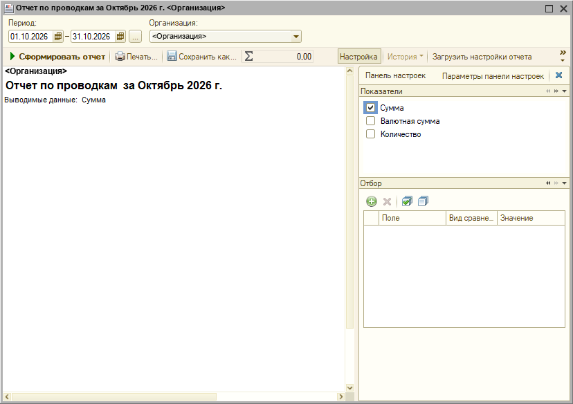 | 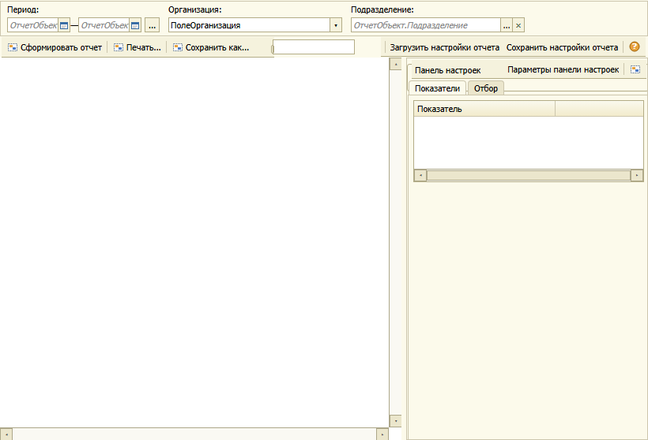 |

* Объект/форма: Reports/ОтчетПоПроводкам, `ФормаОтчета`; размер 820×558 (окно в 1С 828×584). Открыта `Отчеты.ОтчетПоПроводкам ФормаОтчета new`.
* Классы: SpreadsheetDocumentField, 3×Panel (5 Page), 4×InputField, 2×ChoiceField, 4×UsualGroup, 3×Table, 3×CheckBox, Splitter, 7×CommandBar, 57 Button.
* Картинки: `09-rep-provodki-1c.png`, `09-rep-provodki-preview.png`. На снимке 1С название организации тестовой базы заменено на «<Организация>».

### Заметные свойства
* `Результат` (SpreadsheetDocumentField 0,73 508×485): `ShowGrid=true`, `ShowGroups=true` — поле табличного документа (в 1С — белое поле с полосами прокрутки и выведенной шапкой отчёта).
* `Панель` (Panel 0,1 820×46): `ShowTabs None`, `BorderColor #EAE5D8` — верхняя панель параметров без закладок.
* `ПанельПользователя` (Panel 514,73 306×485): `ShowTabs None`; в ней `ПанельЗакладок` (`ShowTabs` code=13, `BackColor #FFFEF7`): страницы «Показатели», «Отбор», «Оформление» — в 1С переключаются заголовками-секциями со сворачиванием («Показатели», «Отбор»).
* `Отбор`, `УсловноеОформление` (Table): `HeaderBackColor #FFFEF7`; первая колонка — `Использование` с редактором CheckBox.
* `ПоказателиОтчета` (Table 6,6 292×104): колонки «Использование» (флажки) и «Показатель».
* Рамки-разделители `РамкаГруппы1/3` (UsualGroup 292×4, `BorderStyle=Frame`, `BorderColor #E3DED2`).
* `ПолеСумма` (InputField 345,50 104×19): `BorderColor #E3DED2`, `FieldBackColor #F8F2E5`, с картинкой-значком (Σ).
* `ДействияФормыОсновные`/`…Дополнительные` (CommandBar): Orientation=Horizontal; вторая — `HorizontalAlign=Right`.

### Отличия «1С — превью»
1. **Заголовок окна и значения.** В 1С — системный заголовок отчёта «Отчет по проводкам за Октябрь 2026 г. …», поля заполнены: период «01.10.2026 – 31.10.2026», выбранная организация. В превью — серые курсивные пути привязки («ОтчетОбъект…»), поле «Организация» показывает имя элемента «ПолеОрганизация».
2. **Скрытое поле.** «Подразделение» есть в превью, но не показано в 1С (видимость задаёт код формы).
3. **Командная панель.** В 1С «Сформировать отчёт» выделена жирным с зелёной стрелкой-треугольником, кнопки «Печать…», «Сохранить как…» — с цветными значками, затем «Σ 0,00» (сумма в поле-индикаторе), «Настройка», «История ▾» (серая, недоступна), «Загрузить настройки отчета» и «»» (переполнение панели). В превью все кнопки с одинаковым серо-синим значком-заглушкой, без выделения, поле суммы — пустой белый прямоугольник.
4. **Панель настроек.** В 1С справа — «Показатели» с флажками (Сумма отмечена) и «Отбор» с таблицей — две секции друг под другом, у каждой заголовок-полоса с кнопками «« » ▾». В превью — закладки «Показатели | Отбор» (вкладки сверху) и таблица «Показатель» одна; режим секций (`ShowTabs` code=13) не отображается.
5. **Табличный документ.** В 1С в области результата уже выведено: название организации, заголовок «Отчет по проводкам за Октябрь 2026 г.» крупным жирным, «Выводимые данные: Сумма»; в превью поле пустое белое (содержимое создаёт код).
6. **Рамки и цвета.** В 1С окно и панели — серо-голубые (системная тема Windows), рамки тонкие; в превью — тёплый бежевый фон `#FCFAEB` и коричневые рамки/шапки таблиц.

### 15. DataProcessors / ОбменДаннымиXML / Форма

| Настоящая 1С | Наше превью |
|---|---|
| 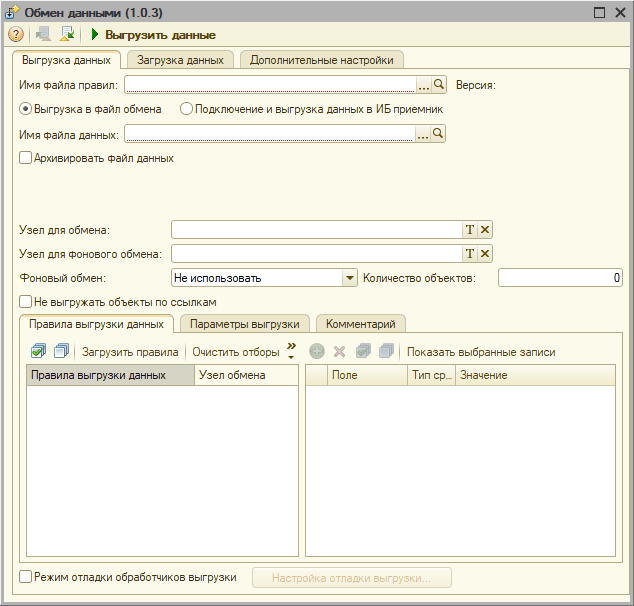 | 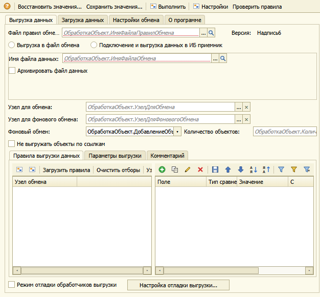 |

* Объект/форма: DataProcessors/ОбменДаннымиXML, `Форма`; размер 626×580 (окно в 1С 634×606). Открыта `Обработки.ОбменДаннымиXML Форма new`.
* Классы: 4×Panel (11 Page), 17×InputField, 3×ChoiceField, 17×CheckBox, 2×RadioButton, 3×Table, 2×UsualGroup, 23×LabelDecoration, Splitter, 3×CommandBar, 24 Button.
* Картинки: `15-dp-xml-1c.png`, `15-dp-xml-preview.png`.

### Заметные свойства
* `ГлавнаяПанельФормы` (Panel 8,28 618×545): `ShowTabs member=Top code=1`, закладки «Выгрузка данных», «Загрузка данных», «Настройки обмена», «О программе» (1С показывает 4, и они стоят в одной строке сверху).
* `ПанельВыгрузки` (Panel 6,245 604×249): `Top`, страницы «Правила выгрузки данных», «Параметры выгрузки», «Комментарий» — вложенная панель закладок.
* `ПанельПараметрыВыгрузки`, `ПанельподключениеИБПриемник`: `ShowTabs None` — панели без закладок, страницы переключаются кодом (два переключателя `RadioButton`).
* `ИмяФайлаПравил`, `ИмяФайлаДанных`, `ИмяФайлаОбмена`: `ChoiceButton`, `OpenButton` (кнопка «…» и «лупа»); ширины 300/322/464.
* `УзелДляОбмена`, `УзелДляФоновогоОбмена` (322×19): `ChoiceButton`, `ClearButton` (в 1С — «T» и «×»).
* `ПарольИнформационнойБазыДляПодключения`: `PasswordMode=true` (150×19).
* `ИмяФайлаПротоколаОбмена`: `ReadOnly=true`. `Комментарий`: `MultiLine=true` (590×218).
* `ПостроительОтбор` (Table 285,31 311×193): колонки Использование (CheckBox) / Поле / Тип сравнения / Значение / С / По.
* `Надпись6` «Имя файла для загрузки:»: `HorizontalAlign=Center`.

### Отличия «1С — превью»
1. **Закладки.** В 1С — три (на этом экране видны «Выгрузка данных», «Загрузка данных», «Дополнительные настройки»), белая активная «приподнята», у остальных светло-серый фон и скруглённый верх. В превью четыре закладки с другими подписями из `Form.xml` («Настройки обмена», «О программе»); заливка бежевая, углы прямые. (Список страниц меняет код формы — 1С скрывает/переименовывает.)
2. **Командная панель.** В 1С панель в окне: «?», затем значки и жирная «▶ Выгрузить данные». В превью панель — текстовые кнопки «Восстановить значения…», «Сохранить значения…», «Выполнить», «Настройки», «Проверить правила» (в 1С эти кнопки скрыты кодом).
3. **Поля ввода.** В 1С — белые с тонкой серой рамкой, справа кнопки «…» и «лупа» одним блоком; «T» и «×» у полей узлов. В превью — серые курсивные пути привязки («ОбработкаОбъект.ИмяФайлаПравилОбмена»), «…» и «лупа» — две отдельные бежевые кнопки, «×» оранжевый.
4. **Таблицы.** В 1С заголовок колонок светло-серый, плоский, с командной панелью (значки: зелёный плюс неактивен, серые значки) и кнопкой «»» переполнения; в превью шапка бежевая, значки яркие и все активны, панель переполнения не рисуется (кнопки обрезаются: «Ус…»).
5. **Выпадающий список.** «Фоновый обмен» в 1С — поле выбора со значением «Не использовать» и стрелкой; в превью — тот же элемент с текстом привязки, стрелка маленькая.
6. **Недоступные элементы.** В 1С кнопка «Настройка отладки выгрузки…» серая, недоступная (текст бледный); в превью — обычная, чёрный текст. Пустое место в середине экрана (скрытые поля) в 1С остаётся пустым, в превью поля показаны.

### 16. DataProcessors / СтартовыйПомощник / Форма

| Настоящая 1С | Наше превью |
|---|---|
| 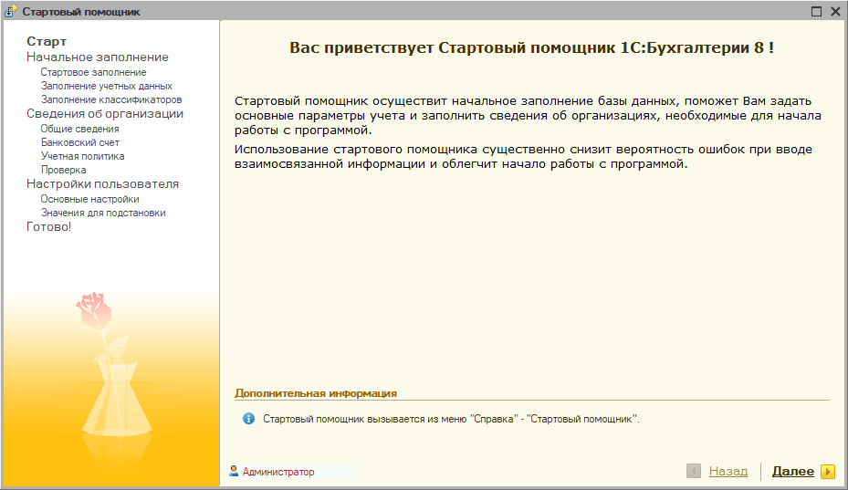 | 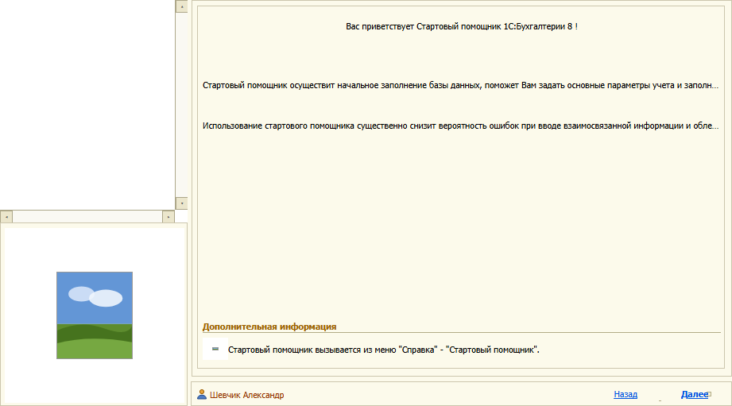 |

* Объект/форма: DataProcessors/СтартовыйПомощник, `Форма`; размер 921×511 (окно в 1С 929×537). Открыта `Обработки.СтартовыйПомощник Форма new`.
* Классы: 9×Panel (28 Page), 80×LabelDecoration, 19×PictureDecoration, 17×UsualGroup, 7×RadioButton, 31×InputField, 3×Table, SpreadsheetDocumentField, Splitter, 20 Button.
* Картинки: `16-dp-start-1c.png`, `16-dp-start-preview.png`.

### Заметные свойства
* `Надпись1` «Вас приветствует Стартовый помощник 1С:Бухгалтерии 8 !» (LabelDecoration 6,6 652×36): `Font face=Verdana` (27 подписей формы с этим шрифтом), `HorizontalAlign=Center`; в 1С — крупный жирный коричневый заголовок.
* Остальные подписи страниц («Начальное заполнение базы данных», «Заполнение учетных данных» …): `Font face=Verdana`, `Center`.
* `РамкаГруппы40` «Дополнительная информация» (UsualGroup 6,396 652×16): `Font bold=true`, `BorderStyle=SingleLine` — подпись + линия.
* `КонвертацияВалюты` (UsualGroup 6,193 653×117): `BorderStyle=Frame` — настоящая рамка вокруг группы полей.
* `ВыполнитьСтартовоеЗаполнение`: `Font bold=true` (кнопка с жирной подписью); `НадписьОткрытьОрганизацию`: `TextColor rgb #0A0000`, гиперссылка.
* Левая навигация («Старт», «Начальное заполнение», …) — цветная картинка-подложка и панель страниц; внизу «Назад» / «Далее» с зелёной/жёлтой стрелкой.
* Картинки (`PictureDecoration`) — логотип «роза», значок «i», стрелки.

### Отличия «1С — превью»
1. **Левая панель.** В 1С слева белая колонка с оглавлением («Старт» жирно, подпункты мельче и с отступом), а ниже — картинка-розовая «роза» на жёлто-оранжевом градиенте. В превью та же область — пустая белая колонка с полосой прокрутки и стандартная заглушка «небо/трава» вместо картинки.
2. **Шрифт подписей.** В 1С заголовок страницы набран Verdana, жирным, коричневым («Вас приветствует…»), основной текст — Verdana 8, переносится по словам (3 строки). В превью заголовок обычным чёрным Tahoma, тексты в одну строку с многоточием («…и заполн…»).
3. **Цвета и фон.** В 1С правая страница на кремовом фоне без рамки, в превью — внутренняя рамка вокруг страницы бежевая, толстая; общая палитра более жёлтая.
4. **Иконки.** В 1С у «Дополнительная информация» голубая иконка «i» в круге; в превью — серый квадрат-заглушка. Значок пользователя «Администратор» красный, подпись в превью — «Шевчик Александр» (из `Caption`).
5. **Кнопки «Назад/Далее».** В 1С — подчёркнутые гиперссылки с цветными стрелками (серая «Назад» неактивна, жирная «Далее» с жёлтой стрелкой); в превью — синие подчёркнутые ссылки без стрелок, «Далее» обрезана справа.
6. **Заголовок окна.** В 1С системный заголовок «Стартовый помощник» с иконкой и кнопками окна; в превью заголовка нет.

## Только превью (снимка 1С нет)

Для этих форм настоящая 1С не запускалась или не дала снимок; картинки показывают, как их рисует превью сейчас.

| № | Форма | Превью |
|---|---|---|
| 03 | Catalogs / Валюты / ФормаСписка | 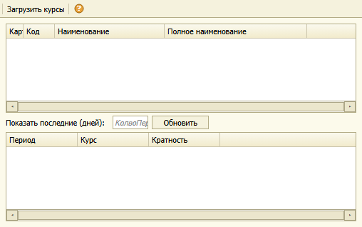 |
| 07 | Documents / ПоступлениеТМЦ / ФормаДокумента | 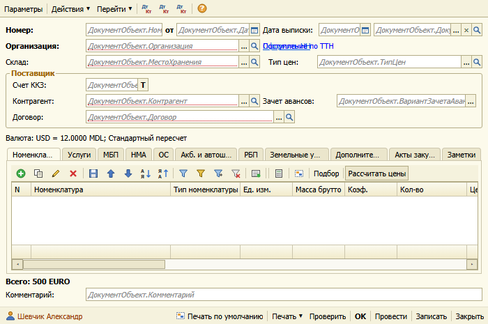 |
| 08 | Documents / ВыгрузкаРегламентированныхОтчетов / ФормаДокумента | 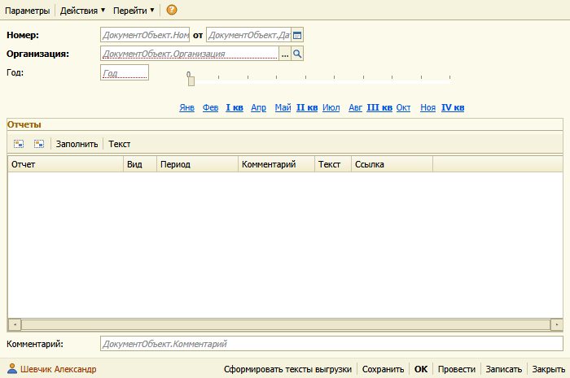 |
| 10 | Reports / АктСверкиВзаиморасчетов / ФормаОтчета | 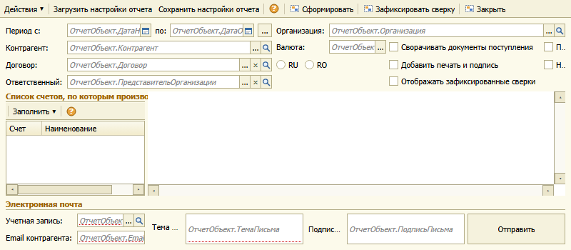 |
| 11 | Reports / ДиаграммаПланСчетовОсновной / Форма | 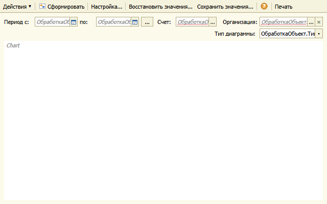 |
| 12 | DataProcessors / ПоискДанных / Форма | 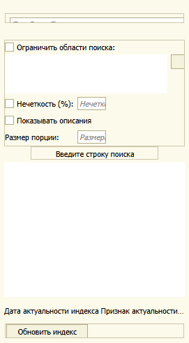 |
| 13 | DataProcessors / ГрупповаяОбработкаСправочниковИДокументов / Форма | 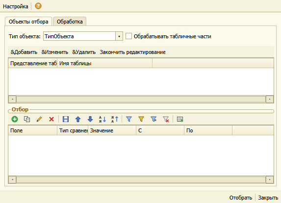 |
| 14 | DataProcessors / Календарь / Форма | 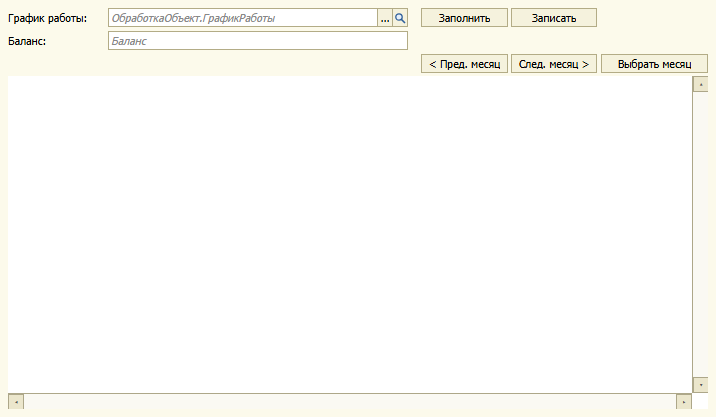 |
| 17 | DataProcessors / ОбщиеОбъектыРегламентированнойОтчетности / УправлениеОтчетностью | 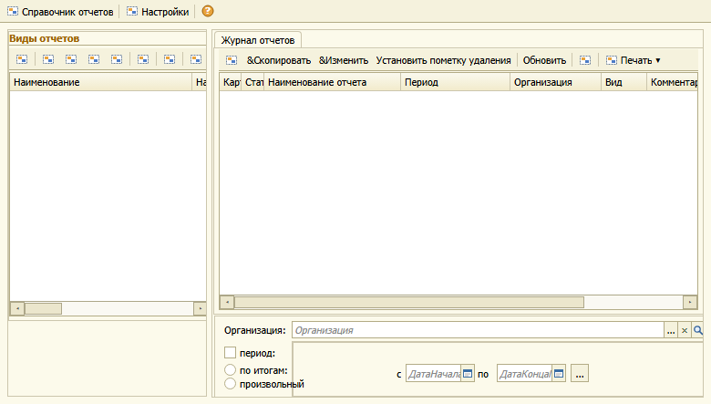 |

